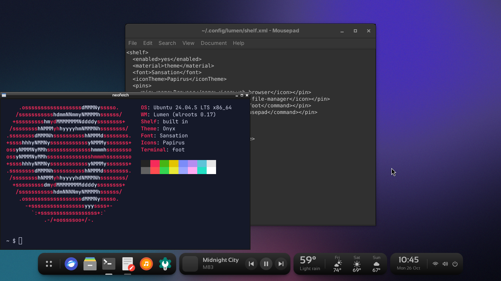
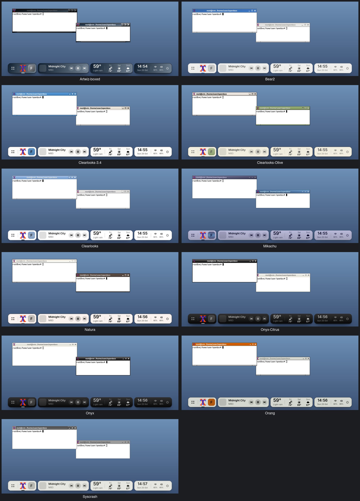
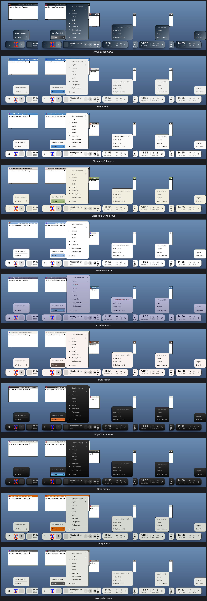

<p align="center">
  <picture>
    <source media="(prefers-color-scheme: dark)" srcset="docs/logo/lumen-dark.svg">
    
  </picture>
</p>

# Lumen Window Manager

**Lumen is a light and fast window manager for X11 and Wayland, with colour themes and a modern floating shelf at the bottom of the
screen.** It gives you a dock with your favourite apps, a music player, the weather, and a clock with wifi,
volume and power controls. It looks like a modern desktop and keeps the speed of Openbox, which it is based on.

> Lumen is a heavily modified fork of [Openbox](http://openbox.org). It installs as `lumen-wm`, and keeps an
> `openbox` command and reads `~/.config/openbox` when `~/.config/lumen` is missing, so your Openbox setup keeps
> working.



*Lumen running as a Wayland compositor, with the Onyx theme, Sansation and Papirus icons: foot with Lumen's
frame, Mousepad and the shelf. The same setup runs on X11.*

The shelf is **off by default**. Until you turn it on, Lumen behaves like plain [Openbox](http://openbox.org).

## Design

Lumen's look is based on [LumaUI](https://hub.simplyluma.com/developer/agents/design-with-lumaui.md), the design system of Luma: content sits in rounded **islands**,
colours come from a small set of tokens with one accent per view, and text keeps at least 4.5:1 contrast. Lumen
applies that language to a window manager: the shelf's dock and status islands, the rounded menus, and
the colours it takes from your window theme.

## What you get

- 🚀 **A dock**: open your pinned apps with one click, switch between open windows, and drag tiles to reorder them.
- 🎵 **A music player**: shows the song and cover, with previous, play/pause and next buttons.
- ⛅ **The weather**: the temperature now and a three-day forecast.
- 🕒 **A status area**: clock and date, plus wifi, volume, power and battery menus.
- 🎨 **Follows your theme**: the shelf and the menus take the colours of the Openbox theme you pick.
- ✨ **Nicer menus**: rounded corners, more space and a soft shadow when a compositor is running.

The player and the weather are optional. Each one only shows up while it has something to show.

## Quick start

### 1. Install it

On Debian or Ubuntu:

```sh
sudo apt-get install build-essential meson ninja-build pkg-config gettext \
  libglib2.0-dev libxml2-dev libpango1.0-dev libcairo2-dev libx11-dev libxft-dev \
  libxrandr-dev libxinerama-dev libxcursor-dev libxi-dev libsm-dev librsvg2-dev libimlib2-dev

# for Wayland too (optional): wlroots 0.17
sudo apt-get install libwlroots-dev libwayland-dev wayland-protocols libxkbcommon-dev \
  libxcb-icccm4-dev libxcb-ewmh-dev

git clone https://github.com/madkoding/lumen-wm
cd lumen-wm
meson setup build --prefix=/usr --sysconfdir=/etc
meson compile -C build
sudo meson install -C build
```

### 2. Turn the shelf on

Open `~/.config/lumen/rc.xml`. If you don't have it, copy the default from `/etc/xdg/openbox/rc.xml`. Find
the `<shelf>` section and set:

```xml
<shelf>
  <enabled>yes</enabled>
</shelf>
```

### 3. Apply it

```sh
lumen-wm --reconfigure
```

The shelf appears at the bottom of the screen. Every time you change `rc.xml`, run this command again.

### On Wayland

When Lumen is built with wlroots, the same `lumen-wm` also runs as a Wayland compositor, with the same `rc.xml`,
themes, shelf and menus. Pick **Lumen (Wayland)** in your display manager, or run `lumen-wm` from a console. It
runs on X11 when `DISPLAY` is set, and on Wayland otherwise; `LUMEN_BACKEND=x11` or `wayland` picks one. Bars,
backgrounds and launchers that use layer-shell work (swaybg, gtk-layer-shell apps), taskbars see the windows
through foreign-toplevel, and X11 applications run through XWayland.

## Make it yours

### Pick a look

The shelf takes the colours of your window theme. Change the theme (for example with `obconf`) and the shelf
changes with it. These are the themes that come with Lumen:



If you prefer fixed colours, choose a material:

```xml
<material>dark</material>    <!-- theme (default) | dark | light -->
```

Or use your own colours. Fill in any of them and leave the rest empty:

```xml
<colors>
  <body>#21252b</body>      <!-- the background of the islands -->
  <text>#e7e9e8</text>      <!-- the text and icons -->
  <hover>#3a3f47</hover>    <!-- the tile under the mouse -->
  <accent>#7aa2f7</accent>  <!-- the mark under the focused app -->
</colors>
```

If a theme's colour would be hard to read, the shelf picks black or white instead.

### Pin your apps

Right click any open app in the dock and choose **Pin to dock**. Choose **Unpin from dock** to remove it.
Drag a pinned app onto another to change the order.

To keep your pins after a restart, tell the shelf where to save them:

```xml
<pinsFile>~/.config/lumen/pins</pinsFile>
```

You can also list them by hand:

```xml
<pins>
  <pin>
    <name>Files</name>
    <icon>system-file-manager</icon>  <!-- an icon name, or the path to an image -->
    <command>pcmanfm</command>        <!-- what runs when you click it -->
  </pin>
</pins>
```

Clicking a pin opens the app. If it is already open, the click brings it to the front, and a second click
minimises it.

### Fonts and icons

```xml
<font>Sansation</font>        <!-- any font installed on your system; empty = the default -->
<iconTheme>Papirus</iconTheme> <!-- the icon theme to look up pin icons in -->
```

### Menus

When the shelf is on, every menu gets rounded corners and more space. With a compositor running (picom,
xcompmgr…), the corners are smooth and there is a soft shadow. Without one, the corners still round but less
smoothly.



```xml
<menuRadius>12</menuRadius>    <!-- how round the corners are; 0 = square -->
<menuPadding>8</menuPadding>   <!-- space around and inside the menus -->
```

## Optional extras

Each extra is a small section inside `<shelf>`. Copy the ones you want. They use common tools (`nmcli`,
`wpctl`, `playerctl`), so install those first.

### Wifi

Click the wifi icon to see nearby networks and connect to one.

```xml
<network>
  <list>nmcli -t -f IN-USE,SIGNAL,SECURITY,SSID dev wifi</list>
  <connect>nmcli dev wifi connect %s</connect>
  <secured>nmcli dev wifi connect %s password %p</secured>
  <password>zenity --entry --hide-text --text=Password</password>
</network>
```

For networks with a password, it asks you for it in a small window. The password is passed to `nmcli` on its
command line, so other users of the machine could see it while it connects.

### Volume

Click for a menu, scroll to change the volume, middle click to mute.

```xml
<volume>
  <level>pamixer --get-volume-human</level>
  <up>wpctl set-volume @DEFAULT_AUDIO_SINK@ 5%+</up>
  <down>wpctl set-volume @DEFAULT_AUDIO_SINK@ 5%-</down>
  <toggle>wpctl set-mute @DEFAULT_AUDIO_SINK@ toggle</toggle>
</volume>
```

### Power and battery

```xml
<power>
  <item><name>Log out</name><command>lumen-wm --exit</command></item>
  <item><name>Restart</name><command>systemctl reboot</command></item>
  <item><name>Shut down</name><command>systemctl poweroff</command></item>
</power>
<battery>yes</battery>   <!-- only appears on machines with a battery -->
```

### Music player

The player shows what your music app is playing. Save this script as `~/.local/bin/shelf-media` and make it
executable (`chmod +x`):

```sh
#!/bin/bash
# prints: status, title, artist, cover
status=$(playerctl status 2>/dev/null) || exit 0
echo "$status"
playerctl metadata --format $'{{title}}\n{{artist}}\n{{mpris:artUrl}}' | sed 's|^file://||'
```

Then add:

```xml
<media>
  <command>~/.local/bin/shelf-media</command>
  <previous>playerctl previous</previous>
  <toggle>playerctl play-pause</toggle>
  <next>playerctl next</next>
</media>
```

### Weather

The weather area shows whatever a script of yours prints: the temperature, the sky, then up to three
`day|temperature|icon` lines. The icon is one of `sun`, `cloud`, `cloud-sun`, `rain`, `snow`, `storm` or
`fog`.

```
59°
Light rain
Fri|74°|cloud-sun
Sat|69°|sun
Sun|67°|cloud
```

```xml
<weather>
  <command>~/.local/bin/shelf-weather</command>
  <interval>900</interval>   <!-- refresh every 15 minutes -->
</weather>
```

## Troubleshooting

- **The shelf doesn't show up.** Check that `<enabled>yes</enabled>` is inside `<shelf>` and run
  `lumen-wm --reconfigure`. It also hides itself while a window is fullscreen.
- **The menus have rough corners and no shadow.** On X11, start a compositor, such as `picom`. On Wayland Lumen
  is the compositor and draws them round already.
- **A pin shows a letter instead of an icon.** That icon name doesn't exist in your `<iconTheme>`. Try another
  name, or give the path to an image.
- **The player or weather is missing.** Run its command in a terminal. If it prints nothing, the shelf hides
  that area.
- **The colours are hard to read with my theme.** Use `<material>dark</material>` or set your own `<colors>`.

## Full configuration

<details>
<summary>Every shelf option in one place</summary>

```xml
<shelf>
  <enabled>yes</enabled>              <!-- off by default -->
  <material>theme</material>          <!-- theme | dark | light -->
  <colors>                            <!-- optional #rrggbb; empty keeps the material's -->
    <body></body><text></text><hover></hover><accent></accent>
  </colors>
  <font></font>                       <!-- empty = the system's sans font -->
  <iconTheme></iconTheme>             <!-- where bare icon names are looked up -->

  <pins>
    <pin>
      <name>Files</name>
      <icon>system-file-manager</icon>
      <command>pcmanfm</command>
      <class>Pcmanfm</class>          <!-- the window's class; default: the command's first word -->
    </pin>
  </pins>
  <pinsFile>~/.config/lumen/pins</pinsFile>  <!-- pins saved from the dock; replaces <pins> once it exists -->

  <network>
    <list>nmcli -t -f IN-USE,SIGNAL,SECURITY,SSID dev wifi</list>
    <connect>nmcli dev wifi connect %s</connect>          <!-- %s: the network's name -->
    <secured>nmcli dev wifi connect %s password %p</secured> <!-- %p: what <password> prints -->
    <password>zenity --entry --hide-text --text=Password</password>
  </network>
  <volume>
    <level>pamixer --get-volume-human</level>
    <up>wpctl set-volume @DEFAULT_AUDIO_SINK@ 5%+</up>
    <down>wpctl set-volume @DEFAULT_AUDIO_SINK@ 5%-</down>
    <toggle>wpctl set-mute @DEFAULT_AUDIO_SINK@ toggle</toggle>
  </volume>
  <power>
    <item><name>Log out</name><command>lumen-wm --exit</command></item>
  </power>
  <battery>yes</battery>
  <batteryDir></batteryDir>           <!-- default: found in /sys/class/power_supply -->

  <menuRadius>12</menuRadius>         <!-- 12 with the shelf on, 0 with it off -->
  <menuPadding>8</menuPadding>        <!-- 8 with the shelf on, 0 with it off -->

  <media>
    <command>~/.local/bin/shelf-media</command>
    <previous>playerctl previous</previous>
    <toggle>playerctl play-pause</toggle>
    <next>playerctl next</next>
    <interval>3</interval>            <!-- seconds -->
  </media>
  <weather>
    <command>~/.local/bin/shelf-weather</command>
    <interval>900</interval>          <!-- seconds -->
  </weather>
</shelf>
```

Commands run in the background, so a slow one never freezes the desktop.

</details>

## Use in Kitties

Lumen is the window manager of [Kitties](https://github.com/madkoding/kitties). Its desktop image comes with
the shelf already set up: the Sansation font, Lucide icons, pinned apps, and music and weather scripts. See its
[desktop docs](https://github.com/madkoding/kitties/blob/main/docs/DESKTOP.md).

## For developers

- The shelf lives in [`openbox/shelf.c`](openbox/shelf.c), and its options are read in `openbox/config.c`.
  Design details are in [`doc/shelf.md`](doc/shelf.md).
- [`tools/shelf-themes.sh`](tools/shelf-themes.sh) takes the screenshots above and checks that the text is
  readable in every theme. Add `COMPOSITOR=1` to try the cairo menus. CI runs it on every pull request.
- Sharing screenshots (README, r/unixporn): see [`doc/screenshots.md`](doc/screenshots.md).
- Building from git: see [`README.GIT`](README.GIT).
- X11 and Wayland: the backends are in [`docs/design/backends.md`](docs/design/backends.md), and the contract
  tests in [`tests/contract`](tests/contract) check the same behaviour on both (`run.sh` on Xvfb,
  `run-wayland.sh` on a headless wlroots output).

## License and credits

Lumen is based on Openbox and, like it, is free software under the GNU General Public License, version 2 or
(at your option) any later version. See [`COPYING`](COPYING). Lumen keeps the original copyright notices and
[`AUTHORS`](AUTHORS), and its own changes, the shelf included, are released under the same licence.

- Openbox: Copyright (C) 2004 Mikael Magnusson, Copyright (C) 2002 Dana Jansens, and all the contributors in
  `AUTHORS`. Upstream: <http://openbox.org>.
- Design: Lumen's look (islands, menus, colour tokens and contrast) is based on
  [LumaUI](https://hub.simplyluma.com/developer/agents/design-with-lumaui.md), Luma's design system. Lumen reimplements that design in C on Openbox; it does not ship Luma
  code, logos or artwork. Lumen is not affiliated with Luma or Openbox.

This program is distributed in the hope that it will be useful, but WITHOUT ANY WARRANTY; without even the
implied warranty of MERCHANTABILITY or FITNESS FOR A PARTICULAR PURPOSE.
