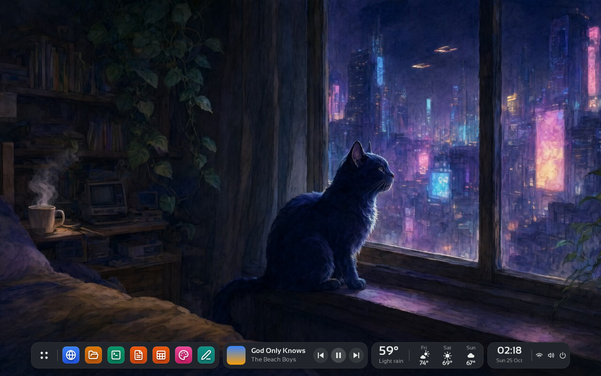

# Openbox (fork with a shelf)

A fork of [Openbox](http://openbox.org), the highly configurable window manager, licensed under the
**GNU GPL v2 or later**. This fork adds an optional **shelf**: a floating dock with pinned apps, a media
player, the weather and a clock/status island, drawn by the window manager itself. Everything else is
upstream Openbox, and the shelf is **off by default**, so without it the fork behaves like Openbox.

It is built for the desktop of [Kitties](https://github.com/madkoding/kitties) (see
[Use in Kitties](#use-in-kitties)) but works on any X11 setup. The shelf's design is inspired by the shelf
of Luma; this project does not use Luma's name or logo.



*Screenshot taken in a test environment (Xvfb, 1280×800) with sample data in the player and the weather.*

## The shelf

The code lives in [`openbox/shelf.c`](openbox/shelf.c) (with `shelf.h`), and the configuration is parsed in
`openbox/config.c`. It is drawn with cairo and pango, takes a bottom strut from the work area, and is hidden
while a fullscreen window has focus. Without a compositor it paints over a copy of the wallpaper; with one,
it uses a 32-bit window with real alpha.

Islands, left to right:

- **Dock**: an applications tile (opens the `root-menu`), your **pinned apps**, then the open windows.
  Left click focuses or minimises, right click opens the client menu, and a mark shows running apps.
- **Player** (optional): cover, title, artist and previous / play-pause / next buttons.
- **Weather** (optional): temperature, sky and a three-day forecast.
- **Status**: time, date, and wifi, volume and power glyphs.

The player and the weather hide themselves while their command prints nothing. More detail (measurements,
the compositor-less mode) is in [`doc/shelf.md`](doc/shelf.md).

### Themes

With `<material>theme</material>` (the default) the shelf follows the Openbox theme in use:


*Regenerate it with [`tools/shelf-themes.sh`](tools/shelf-themes.sh), which also checks, for every theme, that the text reads on
the islands (4.5:1) and on the hovered tile (3:1) and that the running mark shows (3:1). CI runs it
([`shelf-themes.yml`](.github/workflows/shelf-themes.yml)). Every bundled theme with all the islands and the hover on the second tile, in a test environment (Xvfb, no compositor, sample data in the player and the weather).*

Menus (a tile's and its window submenu, then the network's, the volume's and the power's) are Openbox's own,
so they take the theme too; their info lines are menu titles, never selectable:


### Enable and configure it

Edit `~/.config/openbox/rc.xml` (the default is in [`data/rc.xml`](data/rc.xml)) and reconfigure
(`openbox --reconfigure`):

```xml
<shelf>
  <enabled>yes</enabled>              <!-- off by default -->
  <material>theme</material>          <!-- theme | dark | light -->
  <font>Sansation</font>              <!-- empty = the fontconfig sans; or any family -->
  <iconTheme>Lucide</iconTheme>       <!-- where bare icon names are looked up -->

  <pins>                              <!-- pinned apps, in order -->
    <pin>
      <name>Files</name>
      <icon>system-file-manager</icon>  <!-- a bare icon name, or a file path -->
      <command>pcmanfm</command>        <!-- started on click when not running -->
      <class>Pcmanfm</class>            <!-- WM_CLASS; default: the command's first word -->
    </pin>
  </pins>
  <pinsFile>~/.config/kitties/pins</pinsFile> <!-- optional: pins saved from the dock; replaces <pins> once it exists -->

  <!-- the status island's glyphs; each is optional and does nothing without its section -->
  <network>
    <list>nmcli -t -f IN-USE,SIGNAL,SSID dev wifi</list>  <!-- "in-use:signal:name" lines -->
    <connect>nmcli dev wifi connect %s</connect>   <!-- %s: the quoted name -->
    <!-- optional: networks with a password. The list then prints "in-use:signal:security:name"
         (nmcli -t -f IN-USE,SIGNAL,SECURITY,SSID dev wifi); %p is what <password> prints.
         Note: the password is an argument of the command, visible to `ps` while it runs. -->
    <secured>nmcli dev wifi connect %s password %p</secured>
    <password>zenity --entry --hide-text --text=Password</password>
  </network>
  <volume>                            <!-- click: menu, middle click: toggle, wheel: up and down -->
    <level>pamixer --get-volume-human</level>  <!-- optional: shown at the top of the menu -->
    <up>wpctl set-volume @DEFAULT_AUDIO_SINK@ 5%+</up>
    <down>wpctl set-volume @DEFAULT_AUDIO_SINK@ 5%-</down>
    <toggle>wpctl set-mute @DEFAULT_AUDIO_SINK@ toggle</toggle>
  </volume>
  <power>
    <item><name>Log out</name><command>openbox --exit</command></item>
    <item><name>Shut down</name><command>systemctl poweroff</command></item>
  </power>
  <battery>yes</battery>              <!-- shown only when the machine has one -->
  <menuRadius>10</menuRadius>         <!-- rounded corners of every menu; 0 = square -->
  <menuPadding>8</menuPadding>        <!-- air around and inside every menu, in pixels -->

  <media>
    <command>my-media-script</command>  <!-- prints what the island shows -->
    <previous>playerctl previous</previous>
    <toggle>playerctl play-pause</toggle>
    <next>playerctl next</next>
    <interval>3</interval>              <!-- seconds, default 3 -->
  </media>
  <weather>
    <command>my-weather-script</command>
    <interval>900</interval>            <!-- seconds, default 900 -->
  </weather>
</shelf>
```

- **Material**: `theme` (default) takes the shelf's colours from the Openbox theme in use: the island is the
  menu background, the text the menu text, the hover the selected menu item (both keep the theme's gradient: vertical, horizontal, diagonal, split or mirror) and the running mark of the focused
  window the active title bar (with its gradient). Colours that would not read on the island fall back to black or white. `dark` and
  `light` are fixed. Change the theme and reconfigure to see it change.
- **Colours**: `<colors>` with `<body>`, `<text>`, `<hover>` and `<accent>` (`#rrggbb`) replace the colours of
  any material, for a theme that does not suit the shelf. Empty keeps the material's own.
- **Pins**: a click starts the command, or focuses the window of that class (and minimises it if it
  already has focus). Bare icon names are searched in `$XDG_DATA_DIRS/icons/<iconTheme>/`.
- **Reorder**: drag a pinned tile onto another to put it in that place (saved with `<pinsFile>`).
- **Pin and unpin**: right click a tile for *Pin to dock* or *Unpin from dock* (running apps also get their
  window menu). With `<pinsFile>` set, each change is saved there as `name|icon|command|class` lines, and the
  file replaces the `<pins>` of rc.xml from then on. The window's command line, with its arguments, is the command.
- **Status glyphs**: the network glyph opens a menu of the networks `<list>` prints, and picking one runs
  `<connect>`. The volume glyph opens a menu (level, louder, quieter, mute), steps with the wheel and mutes on middle click. The power glyph opens the `<power>`
  items. With `<battery>` and a battery in `/sys/class/power_supply` (or `<batteryDir>`), its glyph joins them and a
  click tells the state. The charge, the active network's signal and the volume (`<level>`) show under their glyphs. Without these sections the glyphs only show.
- **Font**: `Sansation` is the font Kitties uses. Install it and name it in `<font>`.
- **Media command**: prints four lines: `Playing` or `Paused`, the title, the artist and a path to the cover
  (may be empty). The `previous`, `toggle` and `next` commands run on the buttons.
- **Weather command**: prints the temperature, the sky, then up to three `day|temperature|glyph` lines, with
  glyph one of `sun`, `cloud`, `cloud-sun`, `rain`, `snow`, `storm`, `fog`:

  ```
  59°
  Light rain
  Fri|74°|cloud-sun
  Sat|69°|sun
  Sun|67°|cloud
  ```

Commands run asynchronously, one at a time per island, so a slow one never stalls the window manager.

## Build and install

Besides the usual Openbox dependencies, the shelf needs **cairo** (with the xlib backend) and
**pangocairo**; `configure` fails without them. On Debian/Ubuntu:

```sh
sudo apt-get install build-essential autoconf automake libtool pkg-config gettext autopoint \
  libglib2.0-dev libxml2-dev libpango1.0-dev libcairo2-dev libx11-dev libxft-dev \
  libxrandr-dev libxinerama-dev libxcursor-dev libxi-dev libsm-dev librsvg2-dev libimlib2-dev

./bootstrap
./configure --prefix=/usr --sysconfdir=/etc
make
sudo make install
```

`libstartup-notification`, `xcursor`, `imlib2` and `librsvg` are optional upstream dependencies that
`configure` detects. See `README.GIT` for notes on building from git.

## Use in Kitties

[Kitties](https://github.com/madkoding/kitties) runs each kitty's desktop on a headless X display (Xvfb) with
this Openbox. Its `docker/kitty-desktop` image builds the fork at a pinned commit and ships an `rc.xml` with the
shelf enabled, `Sansation` as the font, the Lucide icon theme, pins for the browser, files, terminal and
office apps, and media (MPRIS via `playerctl`) and weather (Open-Meteo) scripts. See its
[desktop docs](https://github.com/madkoding/kitties/blob/main/docs/DESKTOP.md).

## License and credits

Openbox is free software under the GNU General Public License, version 2 or (at your option) any later
version. See [`COPYING`](COPYING). This fork keeps the original copyright notices and `AUTHORS`; the
shelf is released under the same licence.

- Openbox: Copyright (C) 2004 Mikael Magnusson, Copyright (C) 2002 Dana Jansens, and all the contributors in
  [`AUTHORS`](AUTHORS). Upstream: <http://openbox.org>.
- The shelf design is inspired by the shelf of Luma. This project is not affiliated with Luma and does not use its
  name or logo.

This software is OSI Certified Open Source Software. OSI Certified is a certification mark of the Open
Source Initiative.

    This program is distributed in the hope that it will be useful,
    but WITHOUT ANY WARRANTY; without even the implied warranty of
    MERCHANTABILITY or FITNESS FOR A PARTICULAR PURPOSE.
    See the COPYING file for a copy of the GNU General Public License.
